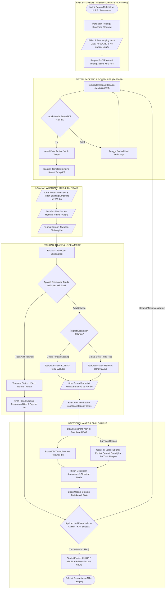

# Alur Kerja Sistem Monitoring Kesehatan Ibu Nifas

Dokumen ini memuat diagram alir (*flowchart*) resmi sistem monitoring kesehatan ibu nifas skala pilot (Surabaya). Diagram menggunakan standar notasi ANSI/ISO:
- **Terminal (Mulai / Selesai)**: Oval / Stadium `([ ... ])`
- **Proses / Eksekusi**: Persegi panjang `[ ... ]`
- **Input / Output Data**: Jajar genjang `[/ ... /]`
- **Keputusan / Percabangan**: Belah ketupat `{" ... "}`
- **Garis Alur**: Orthogonal (koneksi 90 derajat rigid)

> **Catatan Aset Publikasi & Cetak**:  
> Diagram Mermaid di bawah ini digunakan untuk visualisasi Markdown interaktif di GitHub/web viewer. Seluruh aset diagram resmi beresolusi tinggi (300 DPI) untuk dokumen cetak dan Project Charter digenerate langsung menggunakan mesin Python Matplotlib murni via `uv run python tools/report_docs/render_charts.py` dan tersimpan di `docs/assets/`.

---

## 1. Flowchart End-to-End Sistem

---

## 2. Penjelasan Logika & Titik Keputusan

1. **Registrasi Pasien**:
   - Pendaftaran dibantu oleh Bidan bersama Pendamping saat kepulangan agar ibu tidak terbebani administrasi.
   - Mengisi: Nama Ibu, **Nomor WhatsApp Utama Ibu**, **Nomor WhatsApp Darurat (Suami/Keluarga)**, Tanggal/Jam Bersalin, Jenis Persalinan (Normal/SC), Faskes Penanggung Jawab Wilayah.
2. **Kanal Utama vs Kontak Darurat**:
   - **Kanal Utama**: Reminder dan skrining dikirimkan langsung ke nomor WhatsApp Ibu, karena ibu adalah subjek yang merasakan langsung tanda klinis tubuhnya.
   - **Kontak Darurat (Suami)**: Berfungsi sebagai *fail-safe* jika status pasien darurat (Merah) atau ibu tidak memberikan respons skrining dalam kurun 24 jam.
3. **Triase Deterministik**:
   - 🟢 **Hijau**: Respons normal $\rightarrow$ kirim edukasi $\rightarrow$ lanjut siklus hari berikutnya.
   - 🟡 **Kuning**: Respons keluhan ringan/sedang $\rightarrow$ alert ke bidan faskes terkait.
   - 🔴 **Merah**: Respons red flag (perdarahan deras, demam tinggi, nyeri kepala hebat, kejang) $\rightarrow$ instruksi darurat ke ibu + kontak bidan PJ + alert prioritas merah ke bidan.
4. **Siklus Hidup (Lifecycle Loop)**:
   - Intervensi nakes pada satu insiden tidak menghentikan jadwal berikutnya. Sistem terus memantau hingga ambang 42 hari pascasalin (KF4 terpenuhi).
