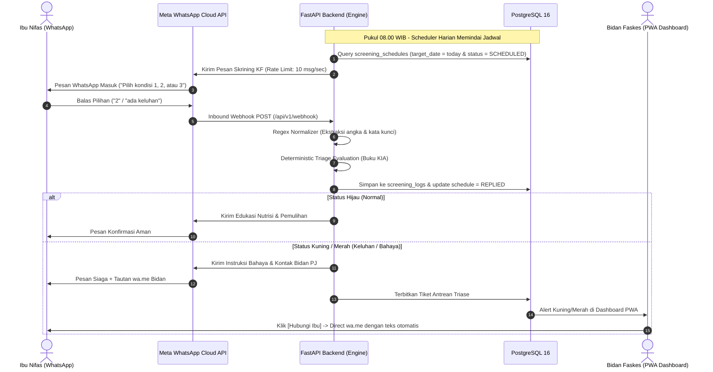

# Sistem Monitoring Kesehatan Ibu Nifas Surabaya (SIM-NIFAS Surabaya)

> **Cabang Fitur (`feature/sim-nifas-discharge-monitoring`)**:  
> Implementasi prototype penuh sesuai **Product Requirement Document (PRD)**: *Sistem Informasi Monitoring Discharge Planning Ibu Nifas Kota Surabaya*.  
> Berfokus pada kontinuitas pemulangan pasien (KRS) dari Rumah Sakit ke FKTP, penegakan **SLA Kunjungan Rumah 48 Jam** ($2 \times 24\text{ jam}$) oleh Bidan Kelurahan, pelaporan via web token tanpa login rumit, serta Dashboard Eksekutif 10 Kartu Indikator KPI Dinkes & Puskesmas.
---

## 1. Dokumen Resmi Proyek (Versi 2.0)

- **Google Docs (Project Charter & Spesifikasi Teknis v2)**:  
  [Buka Google Docs](https://docs.google.com/document/d/1MGuyIH8bSQ3jBsk8kKsxSAsildZA11Rwhq3HyZ4dfA4/edit?usp=drivesdk)  
  *Memuat latar belakang klinis, analogi sistem, alur 5 tahap operasional, protokol Buku KIA Kemenkes, dan roadmap 3 bulan.*

- **Google Spreadsheet (RAB & Matriks Klinis v2)**:  
  [Buka Google Spreadsheet](https://docs.google.com/spreadsheets/d/1J38nXV5J0ri4aM3_s0h6bYo-dELT1FO5RBnxITIlUtc/edit?usp=sharing)  
  *Memuat rincian anggaran biaya pilot (Rp6,3 jt server-only vs Rp13,3 jt field-ready komprehensif) serta kamus lengkap pesan interaktif KF1–KF4 (Tab resmi: `RAB Revisi (3 Bulan)`).*

- **Dokumen Project Charter Formal (DOCX Lokal)**:  
  `docs/PROJECT_CHARTER_MONITORING_NIFAS.docx`  
  *Dokumen Word terstandarisasi dengan caption tabel formal dan flowchart beresolusi tinggi, dibuat via `uv run python tools/report_docs/main.py`.*

- **Diagram Alir ISO/ANSI & Generator Matplotlib**:  
  Lihat [`FLOWCHART.md`](FLOWCHART.md) untuk bagan alir Mermaid orthogonal. Seluruh diagram formal resolusi tinggi (300 DPI) digenerate secara native via Python Matplotlib (`tools/report_docs/render_charts.py`), dengan berkas sumber arsip di `docs/*.drawio`.
- **Pedoman Aturan Kerja & Standar Teknis**:  
  Lihat [`AGENTS.md`](AGENTS.md) untuk dokumentasi lengkap variabel, matriks klinis, dan aturan commit repositori.

### Status Kesiapan Rekayasa Sistem
| Fase Milestone | Cakupan Pekerjaan | Status |
|---|---|---|
| **M1: Desain & Spesifikasi** | Project Charter, RAB v2, Matriks KIA, Flowchart ANSI/ISO | **SELESAI (100%)** ✅ |
| **M2: Backend Core & Engine** | FastAPI, SQLModel, Triage KIA, APScheduler, Seeder 13 Faskes | **SELESAI (100% Lulus Uji)** ✅ |
| **M3: PWA Frontend UI** | Dashboard Triase Bidan, Registrasi Pasien, Panel Dinkes (Next.js 15 + shadcn/ui) | **SELESAI (100% Siap Mockup)** ✅ |
| **M4: Pra-Deployment Lapangan** | Verifikasi WABA Meta, Provisi VPS Biznet GIO, Domain & SSL | **Fase M0 Lapangan** 📋 |
---

## 2. Prinsip Rekayasa Sistem (Core Principles)

1. **Strictly NO LLM (Zero Medical Hallucination)**:  
   Semua penilaian triase dilakukan secara **deterministik berbasis aturan Buku KIA Kemenkes RI**. Tidak ada model bahasa generatif (AI) di alur triase klinis untuk menjamin kepatuhan hukum medis dan kepastian diagnosis banding.
2. **Model Komunikasi Hybrid Dua Sisi**:  
   - **Sisi Bot Pusat**: Menangani pengiriman pesan pengingat terjadwal dan menampung jawaban angka/tombol terstruktur dari ibu nifas.
   - **Sisi Bidan Faskes**: Menerima peringatan (*alert*) di dashboard PWA dan menghubungi ibu via tautan 1-klik `wa.me` dengan sapaan otomatis (*pre-filled text*).
3. **Primary & Emergency Fail-Safe Contact**:  
   - **Nomor Utama (Ibu)**: Menerima seluruh kuesioner skrining langsung karena ibu adalah pihak yang merasakan kondisi fisiknya.
   - **Kontak Darurat (Suami/Keluarga)**: Didaftarkan sebagai jalur evakuasi jika ibu mengalami tanda bahaya kritis (🔴 Merah) atau tidak merespons pengingat dalam 24 jam.
4. **Siklus Hidup Penuh 42 Hari**:  
   Penanganan suatu insiden keluhan pada KF1 atau KF2 tidak menghentikan jadwal sistem. Sistem tetap aktif mengawal ibu hingga genap hari ke-42 (KF4) dan dinyatakan lulus pemantauan.
5. **Isolasi Data Multi-Tenant (Tenant Scoping)**:  
   Bidan di suatu faskes hanya dapat melihat data pasien binaan wilayahnya. Dinas Kesehatan memiliki akses agregat seluruh kota.
6. **Murni Standalone**:  
   Tidak memiliki dependensi runtime ke SIMPUS atau SatuSehat pada fase pilot, memastikan keandalan 100% dan kecepatan deploy.

---

## 3. Arsitektur Aliran Data (Low-Level Architecture)



---

## 4. Struktur Direktori Proyek

```
pengmas-rs-surabaya/
├── app/
│   ├── api/
│   │   ├── deps.py               # Dependency header tenant X-Faskes-ID & X-User-Role
│   │   └── v1/
│   │       ├── faskes.py         # Endpoint master RS/Puskesmas & metrik agregat
│   │       ├── mothers.py        # Pendaftaran discharge planning & profil ibu
│   │       ├── triage.py         # Antrean triase bidan, 1-klik wa.me & intervensi
│   │       └── webhook.py        # Meta Webhook verification & incoming chat handler
│   ├── core/
│   │   └── config.py             # Pydantic Settings (.env configuration)
│   ├── db/
│   │   ├── session.py            # Engine SQLModel (PostgreSQL dengan fallback SQLite)
│   │   └── seed.py               # Seeder 13 Faskes Surabaya & 5 sampel kohort nifas
│   ├── models/
│   │   ├── enums.py              # Enum klinis, status pemantauan, dan peran pengguna
│   │   ├── faskes.py             # Model tabel faskes
│   │   ├── user.py               # Model tabel users
│   │   ├── mother.py             # Model tabel mothers & emergency_contacts
│   │   ├── screening.py          # Model tabel screening_schedules & screening_logs
│   │   ├── intervention.py       # Model tabel interventions (disposisi nakes)
│   │   └── audit.py              # Model tabel audit_logs (UU PDP No. 27/2022)
│   ├── services/
│   │   ├── triage_engine.py      # Evaluasi triase KIA & regex normalizer input
│   │   ├── whatsapp_service.py   # Meta Graph API client & generator direct wa.me
│   │   └── scheduler.py          # APScheduler cron 08.00 WIB & batch rate limiter
│   └── main.py                   # Inisialisasi FastAPI, lifespan, CORS, dan Swagger UI
├── docs/                         # Dokumen charter docx, flowchart draw.io & panduan desain
│   ├── Flowchart_1_manual.drawio # Arsip draw.io alur onboarding & pendaftaran
│   ├── Flowchart_2.drawio        # Arsip draw.io alur triase deterministik KIA
│   ├── Flowchart_3.drawio        # Arsip draw.io alur intervensi klinis bidan
│   ├── Flowchart_4.drawio        # Arsip draw.io integrasi RBAC Dinkes Surabaya
│   ├── DRAWIO_STYLE_GUIDE.md     # Panduan standarisasi visual dan palet warna medis
│   ├── PROJECT_CHARTER_MONITORING_NIFAS.docx # Dokumen resmi charter nifas
│   └── assets/                   # Render gambar PNG flowchart (300 DPI) untuk dokumen
├── tests/
│   └── smoke_test.py             # 9 pengujian end-to-end terautomasi
├── tools/report_docs/            # Engine diagram Matplotlib & builder DOCX lokal
│   ├── chart_engine.py           # Engine perutean ortogonal & shapes Matplotlib
│   ├── flowchart_definitions.py  # Definisi 4 alur diagram (Onboarding, Triase, Intervensi, Master)
│   ├── render_charts.py          # Runner render aset gambar PNG (300 DPI)
│   ├── builder.py                # Modul perakit dokumen DOCX berbasis OpenXML
│   └── main.py                   # Entrypoint kompilasi Project Charter DOCX
├── docker-compose.yml            # Layanan PostgreSQL 16 containerized
├── pyproject.toml                # Dependensi Python terkelola via Astral uv
├── .env.example                  # Template variabel lingkungan aman
├── FLOWCHART.md                  # Dokumentasi diagram alir Mermaid ANSI/ISO
├── main.py                       # Root runner entrypoint praktis
├── AGENTS.md                     # Pedoman aturan agen, RAB, & matriks klinis
└── README.md                     # Dokumentasi arsitektur teknis sistem
```

---

## 5. Skema Basis Data & Entitas Utama

Sistem menggunakan **SQLModel** (kombinasi SQLAlchemy Core + Pydantic v2):

| Tabel | Keterangan Entitas | Relasi Kunci |
|---|---|---|
| `faskes` | Master 13 Faskes (RSUD & Puskesmas di Surabaya) | 1-ke-banyak dengan `mothers` dan `users` |
| `users` | Akun Bidan Jaga, Admin Faskes, dan Super Admin Dinkes | Terikat pada `faskes_id` |
| `mothers` | Data ibu nifas, waktu bersalin, metode persalinan, paritas | Induk siklus hidup pemantauan |
| `emergency_contacts` | Kontak darurat suami/pendamping keluarga | Terikat 1-ke-1 dengan `mother_id` |
| `screening_schedules` | Linimasa 4 jadwal otomatis (KF1, KF2, KF3, KF4) | Menyimpan status pengiriman & WABA ID |
| `screening_logs` | Catatan riwayat jawaban pasien, angka opsi, skor warna triase | Terikat dengan `schedule_id` dan `mother_id` |
| `interventions` | Rekam tindakan klinis bidan (WA, telepon, rujukan, home visit) | Terikat dengan `screening_log_id` dan `user_id` |
| `audit_logs` | Jejak audit akses data medis untuk kepatuhan hukum UU PDP | Mencatat aksi, IP, user-agent, dan record ID |

---

## 6. Protokol Klinis & Logika Triase Deterministik

### Matriks Pertanyaan & Poin Triase (Buku KIA Kemenkes RI)

1. **Onboarding (Hari ke-0 / Saat Pulang)**:
   - Pertanyaan: Sapaan resmi dan konfirmasi keikutsertaan.
   - Pilihan: Balas `YA` $\rightarrow$ Status bertransisi dari `ONBOARDING_PENDING` menjadi `AKTIF`.
2. **KF1 (Hari ke-1 s/d ke-2)**:
   - Opsi 1: Aman, perdarahan wajar $\rightarrow$ 🟢 **HIJAU**
   - Opsi 2: Pusing berat, pandangan kabur, nyeri perut hebat, darah deras $\rightarrow$ 🔴 **MERAH** (Risiko perdarahan primer, atonia uteri, preeklampsia postpartum).
3. **KF2 (Hari ke-3 s/d ke-7)**:
   - Opsi 1: Aman, lochea merah kecokelatan tanpa bau busuk, ASI lancar $\rightarrow$ 🟢 **HIJAU**
   - Opsi 2: Payudara bengkak/nyeri, puting lecet $\rightarrow$ 🟡 **KUNING** (Bendungan ASI / mastitis dini).
   - Opsi 3: Demam menggigil (>38°C), lochea berbau busuk $\rightarrow$ 🔴 **MERAH** (Infeksi nifas / sepsis puerperalis).
4. **KF3 (Hari ke-8 s/d ke-28)**:
   - Opsi 1: Luka membaik/kering, lochea berkurang $\rightarrow$ 🟢 **HIJAU**
   - Opsi 2: Bekas jahitan nyeri/terbuka/bernanah, kaki bengkak berat, tensi naik $\rightarrow$ 🔴 **MERAH** (Infeksi luka jahitan SC/perineum, DVT).
5. **KF4 (Hari ke-29 s/d ke-42)**:
   - Opsi 1: Sehat fisik dan psikologis, sudah ada rencana KB $\rightarrow$ 🟢 **HIJAU**
   - Opsi 2: Cemas berlebih, sedih berkepanjangan, sulit tidur $\rightarrow$ 🟡 **KUNING** (Skrining awal depresi postpartum / EPDS).
   - Opsi 3: Belum memahami pilihan KB pascasalin $\rightarrow$ 🟡 **KUNING** (Konseling kontrasepsi).

### Normalisasi Variasi Input Pasien
Pasien di lapangan tidak selalu mengetik angka tunggal. Fungsi `normalize_reply()` menangani variasi input melalui regex deterministik:
- Digit terisolasi: `"1"`, `"1."`, `"pilihan 2"`, `"no 3"`.
- Ejaan kata: `"satu"`, `"dua"`, `"tiga"`.
- Kata afirmasi: `"ya"`, `"iya"`, `"setuju"`, `"siap"`, `"nggih"`, `"monggo"`.
- Kata kunci keluhan: `"darah"`, `"pusing"`, `"nyeri"`, `"demam"`.
- Jika masukan berupa stiker/pesan tidak terbaca, bot mengirim balasan santun meminta input angka dan menyertakan kontak Bidan PJ.

---

## 7. Model Keamanan & Isolasi Data (Multi-Tenant)

Untuk memenuhi prinsip kerahasiaan rekam medis, sistem menerapkan isolasi tenant melalui header HTTP:

- **Bidan Faskes (Tenant-Scoped)**:  
  Setiap permintaan dari PWA menyertakan header `X-Faskes-ID: <id_faskes>`. Backend secara otomatis memfilter seluruh kuari database (daftar ibu, antrean triase, riwayat tindakan) hanya untuk faskes tersebut.
- **Super Admin (Dinas Kesehatan)**:  
  Jika header `X-Faskes-ID` tidak disertakan (atau role pengguna adalah `SUPER_ADMIN_DINKES`), backend menyajikan data komprehensif seluruh 13 faskes di Surabaya untuk keperluan analitik epidemiologi kota.
- **Jejak Audit Medis (UU PDP No. 27/2022)**:  
  Setiap penambahan atau pembaruan rekam tindakan klinis secara otomatis dicatat ke tabel `audit_logs` bersama identitas pengguna, alamat IP, dan *user-agent*.

---

## 8. Panduan Menjalankan Sistem (Developer Quickstart)

### Prasyarat
- Python 3.12+ & Astral `uv` (`curl -LsSf https://astral.sh/uv/install.sh | sh`)
- Node.js 20+ & `pnpm` (atau `npm`)
- Docker & Docker Compose (opsional, jika tidak ada sistem otomatis fallback ke SQLite lokal `nifas_dev.db`)

---

### 🚀 Cara Paling Praktis (Unified 2-Command Quickstart)

Cukup jalankan 2 perintah berikut di root folder proyek:

```bash
# Langkah 1: Setup otomatis (buat .env jika belum ada, uv sync, seed DB PRD, & install frontend)
pnpm run setup   # atau: npm run setup / make setup

# Langkah 2: Jalankan Backend & Frontend sekaligus dalam 1 terminal
pnpm run dev     # atau: npm run dev / make dev
```

> **Catatan**: Perintah `dev` menjalankan server FastAPI (`localhost:8000`) dan Next.js Turbopack (`localhost:3000`) secara bersamaan dengan label output berwarna. Saat `Ctrl+C` ditekan, kedua server dimatikan secara bersih tanpa meninggalkan proses zombie di port 8000/3000.

---

### 📋 Tabel Perintah Cepat (Root Command Reference)

| Perintah (npm / pnpm) | Perintah (Make) | Deskripsi / Fungsi |
|---|---|---|
| `pnpm run setup` | `make setup` | Setup otomatis awal (.env, `uv sync`, `prd_seed`, frontend install). |
| `pnpm run dev` | `make dev` | Menjalankan Backend (port 8000) & Frontend (port 3000) sekaligus. |
| `pnpm run dev:backend` | `make dev-backend` | Menjalankan hanya Backend FastAPI (`app.main:app --reload`). |
| `pnpm run dev:frontend` | `make dev-frontend` | Menjalankan hanya Frontend PWA Next.js 16. |
| `pnpm run seed` | `make seed` | Mengisi data master wilayah Surabaya, 6 RS, dan data uji awal. |
| `pnpm test` | `make test` | Menjalankan 10 skenario smoke test terautomasi PRD SIM-NIFAS. |
| `pnpm run test:all` | `make test-all` | Menjalankan smoke test PRD dan smoke test klinis legacy. |
| `pnpm run build:frontend` | `make build-frontend` | Menguji build produksi frontend Next.js. |

---

### ⚙️ Alur Manual Langkah demi Langkah (Opsional)

Bila ingin menjalankan setiap komponen secara terpisah:

1. **Persiapan Environment**:
   ```bash
   cp .env.example .env
   uv sync
   ```
2. **Basis Data**:
   - **PostgreSQL**: `docker compose up -d`
   - **SQLite**: Otomatis aktif jika Docker tidak berjalan (`nifas_dev.db`).
3. **Seeding Database**:
   ```bash
   uv run python -m app.db.prd_seed
   ```
4. **Menjalankan Backend**:
   ```bash
   uv run uvicorn app.main:app --reload --port 8000
   ```
5. **Menjalankan Frontend**:
   ```bash
   cd frontend && pnpm dev
   ```

Buka browser di:
- Frontend: **`http://localhost:3000`** (`/dinkes`, `/register`, `/visit/[token]`, `/simulator`, `/triage`)
- Swagger API Docs: **`http://localhost:8000/docs`**

---

## 9. Verifikasi Otomatis (Smoke Test Suite)

Jalankan pengujian otomatis end-to-end PRD SIM-NIFAS:

```bash
PYTHONPATH=. uv run python -m tests.prd_smoke_test
```

Rangkaian pengujian memverifikasi 10 skenario inti:
1. Ketersediaan master data hierarki wilayah (Kecamatan, Puskesmas, Kelurahan).
2. Ketersediaan master data Rumah Sakit Rujukan Surabaya.
3. Pendaftaran pemulangan pasien (KRS) oleh Bidan RS dan penetapan SLA 48 jam.
4. Pembuatan token kunjungan unik dan audit log notifikasi WhatsApp (`WA-ASSIGN-01`, `WA-EDU-PASIEN`).
5. Akses formulir kunjungan rumah via URL token tanpa otentikasi rumit.
6. Pelaporan kunjungan rumah tepat waktu (&le;48 jam) dan deteksi triase tanda bahaya (suhu >38°C).
7. Penerbitan status kedaruratan *Red Alert* dan notifikasi darurat `WA-EMERGENCY`.
8. Kalkulasi 10 kartu indikator utama KPI pada dashboard eksekutif Dinkes.
9. Pengambilan daftar operasional pasien beserta status SLA dan link kunjungan.
10. Penyelesaian kasus darurat (*resolve*) dan pengarsipan tindakan medis.
---

## 10. Contoh Uji Endpoint Cepat (cURL)

### 1. Cek Antrean Triase Faskes (Puskesmas Jagir)
```bash
curl -X GET "http://localhost:8000/api/v1/triage/queue" \
  -H "X-Faskes-ID: 4"
```

### 2. Simulasi Webhook Pesan Masuk dari Ibu
```bash
curl -X POST "http://localhost:8000/api/v1/webhook" \
  -H "Content-Type: application/json" \
  -d '{"from": "081230000003", "text": "2"}'
```

### 3. Pendaftaran Ibu Nifas Baru saat Pulang
```bash
curl -X POST "http://localhost:8000/api/v1/mothers" \
  -H "Content-Type: application/json" \
  -H "X-Faskes-ID: 4" \
  -d '{
    "faskes_id": 4,
    "nik": "3578012345670001",
    "no_rm": "RM-2026-7788",
    "nama_ibu": "Ny. Nurul Hidayati",
    "no_wa_ibu": "081234567890",
    "waktu_persalinan": "2026-10-06T10:00:00Z",
    "metode_persalinan": "SPONTAN",
    "paritas": "P1A0",
    "status_pemantauan": "ONBOARDING_PENDING",
    "nama_suami": "Bpk. Agus Salim",
    "no_wa_suami": "081234567891",
    "hubungan": "SUAMI"
  }'
```

---
## 11. Generator Diagram Alir & Laporan Formal

Repositori menyediakan toolchain lokal murni Python untuk merender diagram beresolusi tinggi (300 DPI) dan mengompilasi dokumen Project Charter:

```bash
# 1. Render ulang seluruh gambar flowchart (300 DPI) ke docs/assets/
uv run python tools/report_docs/render_charts.py

# 2. Kompilasi dokumen resmi Project Charter DOCX
uv run python tools/report_docs/main.py
```

---

## 12. Informasi Keamanan & Kerahasiaan

Repositori ini **bebas dari kredensial rahasia, nomor telepon pribadi, dan token produksi**. Variabel pada `.env.example` menggunakan nilai contoh (*dummy*) untuk simulasi lokal. Token akses Meta Cloud API dan basis data produksi dikonfigurasikan secara terisolasi pada lingkungan server deployment.
